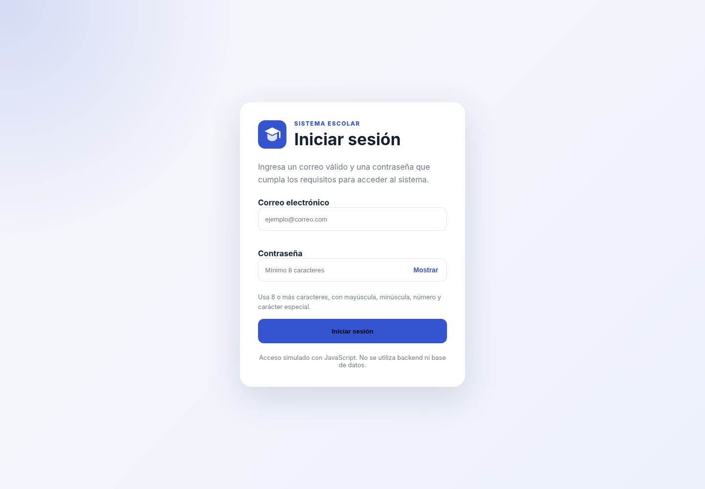
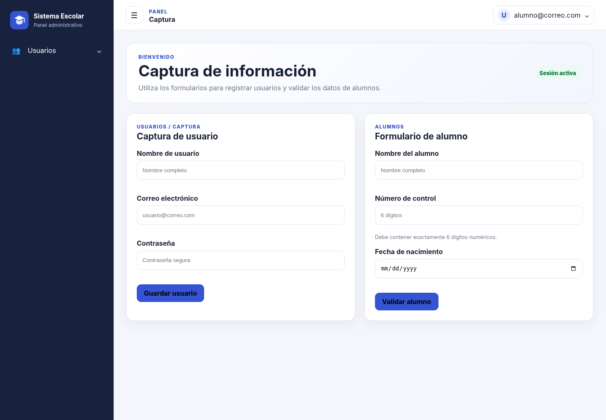
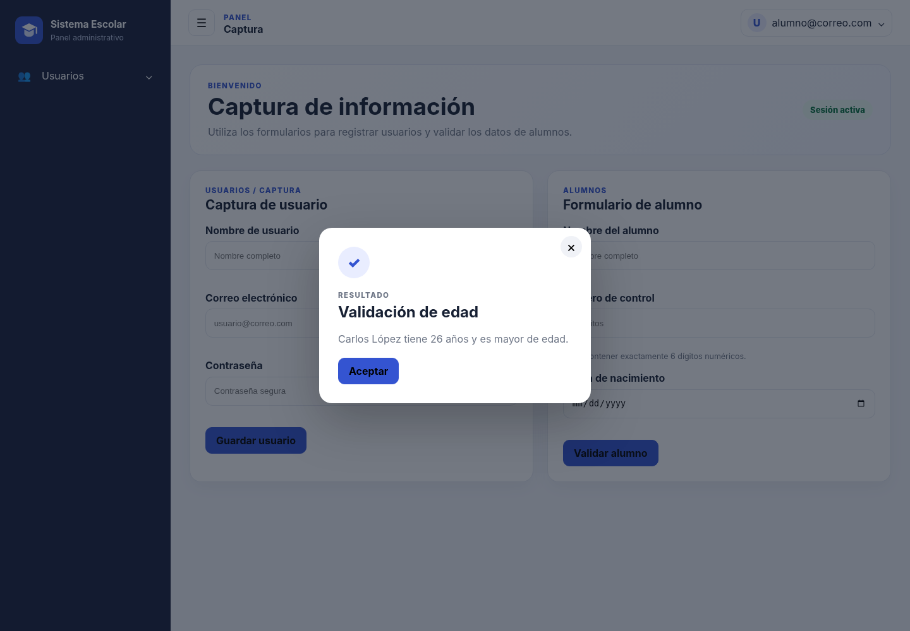

# Sistema Escolar — Login funcional con HTML, CSS y JavaScript

> Proyecto académico que simula el acceso a un sistema mediante un login validado con JavaScript y un panel interno con sidebar, navbar, formularios y modal de edad.

## Portada

**Nombre del proyecto:** Sistema Escolar — Login y panel administrativo  
**Materia:** Desarrollo Web  
**Integrante:** [Escribe aquí tu nombre completo]  
**Modalidad:** Trabajo individual (confirmar con el docente, ya que la consigna original solicita 2 integrantes)  
**Fecha:** [Fecha de entrega]

---

## Descripción

El proyecto está formado por dos pantallas conectadas:

1. `login.html`: valida correo y contraseña con JavaScript. Si los datos cumplen las reglas, guarda el correo temporalmente en `sessionStorage` y redirige a `index.html`.
2. `index.html`: muestra el sistema interno, incluyendo sidebar, menú Usuarios > Captura, navbar con el usuario que inició sesión, formularios, validación del número de control y modal de mayoría de edad.

El proyecto **no utiliza backend ni base de datos**. El acceso es una simulación del lado del cliente, tal como solicita la actividad.

---

## Tecnologías utilizadas

- HTML5
- CSS3
- JavaScript (Vanilla JS)
- Bootstrap 5.3 como base de estilos mediante CDN
- `sessionStorage` para conservar temporalmente el usuario durante la sesión
- Git y GitHub
- GitHub Pages

> No se utilizan React, Vue ni otros frameworks de JavaScript.

---

## Estructura del proyecto

```text
proyecto-login-sistema/
├── login.html
├── index.html
├── README.md
├── css/
│   ├── login.css
│   └── style.css
├── js/
│   ├── login.js
│   ├── index.js
│   └── utileria.js
├── img/
│   └── logo.svg
└── docs/
    └── capturas/
        ├── 01-login.png
        ├── 02-index.png
        └── 03-modal-edad.png
```

---

## Flujo del login hacia el sistema

1. El usuario captura correo y contraseña en `login.html`.
2. `login.js` llama a `validarCorreo()` y `validarPassword()` desde `utileria.js`.
3. Si existe un error, se muestran mensajes debajo del campo correspondiente.
4. Si los datos son válidos, se guarda el correo con:

```javascript
sessionStorage.setItem('usuarioLogin', correo);
```

5. Después se redirige al sistema:

```javascript
window.location.href = 'index.html';
```

6. Al cargar `index.html`, `index.js` recupera el usuario:

```javascript
const usuarioSesion = sessionStorage.getItem('usuarioLogin');
```

7. Ese valor se coloca en el navbar.
8. Al elegir **Salir del sistema**, se elimina la sesión y se regresa al login.

---

## Métodos principales

### `validarCorreo(correo)`

Verifica que el texto tenga estructura válida de correo electrónico.

### `validarPassword(password)`

Comprueba que la contraseña tenga:

- mínimo 8 caracteres;
- una letra mayúscula;
- una letra minúscula;
- un número;
- un carácter especial.

### `validarNumeroControl(numeroControl)`

Valida que el número de control tenga exactamente 6 dígitos numéricos.

### `calcularEdad(fechaNacimiento)`

Calcula la edad actual del alumno considerando si ya ocurrió su cumpleaños en el año actual.

---

## Proceso de creación

### 1. Creación del login

Se creó `login.html` con dos campos: correo electrónico y contraseña. El diseño utiliza Bootstrap como base y estilos personalizados en `css/login.css`.



### 2. Validaciones del login

En `js/login.js` se validan los dos campos mediante las funciones de `utileria.js`. Si ambos son correctos, el correo se guarda temporalmente y se abre `index.html`.

### 3. Creación del sidebar

En `index.html` se agregó un menú lateral con botón hamburguesa para expandirlo o contraerlo. El menú **Usuarios** contiene el submenú **Captura**.

### 4. Creación del navbar con usuario

La barra superior recupera el correo guardado durante el login y lo muestra a la derecha. Al hacer clic se abre un menú con la opción **Salir del sistema**.



### 5. Captura de usuario

El formulario solicita:

- nombre de usuario;
- correo electrónico;
- contraseña.

El correo y la contraseña se validan reutilizando `validarCorreo()` y `validarPassword()`.

### 6. Formulario de alumnos

El formulario solicita nombre, número de control y fecha de nacimiento. El número de control debe contener exactamente 6 dígitos.

### 7. Modal de edad

Después de validar la fecha de nacimiento, el sistema calcula la edad y muestra un modal indicando si el alumno es mayor o menor de edad.



### 8. Cierre de sesión

El botón **Salir del sistema** elimina el dato guardado en `sessionStorage` y regresa a `login.html`.

---

## Cómo probar el proyecto

1. Abre `login.html` desde un servidor local o GitHub Pages.
2. Captura un correo válido, por ejemplo `alumno@correo.com`.
3. Captura una contraseña válida, por ejemplo `Alumno123*`.
4. Presiona **Iniciar sesión**.
5. Verifica que `index.html` muestre el correo en el navbar.
6. Prueba Usuarios > Captura.
7. Captura un número de control de 6 dígitos.
8. Selecciona una fecha de nacimiento y verifica el modal de edad.
9. Desde el navbar selecciona **Salir del sistema** y comprueba que regrese al login.

---

## Publicación en GitHub Pages

1. Crear un repositorio público en GitHub.
2. Subir todos los archivos conservando la estructura de carpetas.
3. Entrar a **Settings** del repositorio.
4. Abrir la sección **Pages**.
5. En **Build and deployment**, elegir **Deploy from a branch**.
6. Seleccionar la rama `main` y la carpeta `/ (root)`.
7. Guardar los cambios.
8. Esperar a que GitHub muestre la URL pública.
9. Para que el enlace principal abra directamente el login, puede renombrarse `login.html` a `index.html` únicamente si también se ajusta la pantalla interna; para esta actividad es preferible conservar las dos pantallas solicitadas y compartir directamente la URL que termina en `/login.html`.

### Enlaces de entrega

- **Repositorio:** [Pega aquí la URL del repositorio]
- **GitHub Pages:** [Pega aquí la URL pública que termina en `/login.html`]

---

## Historial de commits sugerido

Los commits deben hacerse conforme se construye el proyecto, por ejemplo:

```text
chore: crear estructura inicial del proyecto
feat: crear pantalla de login
feat: agregar validaciones de correo y contraseña
feat: guardar usuario y redirigir al sistema
feat: crear sidebar y submenu de usuarios
feat: crear navbar y mostrar usuario de la sesion
feat: agregar formulario de captura de usuario
feat: validar numero de control del alumno
feat: agregar calculo y modal de edad
feat: implementar cierre de sesion
style: mejorar diseño responsive
README: documentar flujo y capturas del proyecto
```

> La consigna original solicita dos integrantes con una participación aproximada 50/50. Si el proyecto se realiza individualmente, debe confirmarse con el docente cómo se evaluará ese apartado. No es recomendable falsificar commits de otra persona.

---

## Resultado esperado

El flujo final debe ser:

```text
login.html
   ↓
validación con utileria.js
   ↓
sessionStorage
   ↓
index.html
   ↓
sidebar + formularios + modal
   ↓
navbar > Salir del sistema
   ↓
login.html
```
